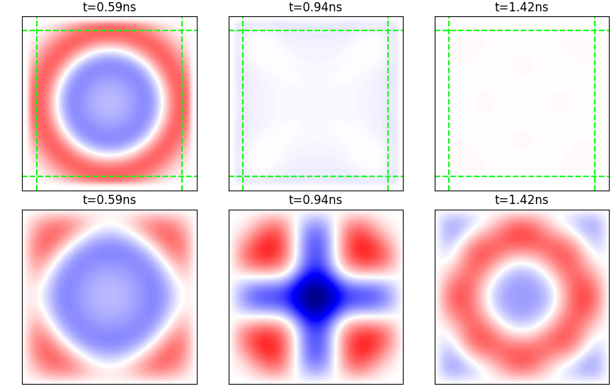

# Hello, I'm Ali

I am a physicist and simulation developer.

## About me

My work is mainly focused on computational electromagnetics and device simulation, including finite element and FDTD methods, mode solvers, TCAD, RF and microwave lines and numerical validation, for applications in integrated photonics and microwave engineering. I hold an MSc in Physics and Mathematics from the University of Granada and work on open-source simulation tools.

### Follow me

## Code

I develop and contribute to open-source numerical tools, mostly in Python, for electromagnetic and photonic simulation.

**Open source contributions**

<table>
<tr>
<td width="31%" valign="top">
<h3><a href="https://github.com/gdsfactory/gsim">gsim</a></h3>

  
<b>Methods:</b> Finite element and FDTD workflows, meshing, benchmarking 
<b>Physics:</b> Electromagnetics for photonics and RF devices 
<b>Tools:</b> Python, Palace, gdsfactory
</td>
<td width="42%" valign="middle" align="center">

</td>
<td width="27%" valign="top">
Electromagnetic simulation for photonics and electronics. I contribute to its solver workflows, benchmarks and documentation.
</td>
</tr>
</table>

<table>
<tr>
<td width="31%" valign="top">
<h3><a href="https://github.com/awslabs/palace">Palace</a></h3>

  
<b>Methods:</b> Finite element method: eigenmode, driven and electrostatic solvers 
<b>Physics:</b> Computational electromagnetics, microwave and superconducting devices 
<b>Tools:</b> C++, MFEM, PETSc
</td>
<td width="42%" valign="middle" align="center">

</td>
<td width="27%" valign="top">
3D finite element solver for computational electromagnetics. I contribute fixes and improvements upstream.
</td>
</tr>
</table>

<table>
<tr>
<td width="31%" valign="top">
<h3><a href="https://github.com/scikit-rf/scikit-rf">scikit-rf</a></h3>

  
<b>Methods:</b> Network analysis, calibration, de-embedding, circuit modelling 
<b>Physics:</b> RF and microwave engineering 
<b>Tools:</b> Python, NumPy
</td>
<td width="42%" valign="middle" align="center">

</td>
<td width="27%" valign="top">
RF and microwave engineering in Python: network analysis, calibration and circuit modelling.
</td>
</tr>
</table>

**Scientific software.** Solvers I wrote from scratch, validated against analytical or published results.

<table>
<tr>
<td valign="top">
<a href="https://alisama20.github.io/#tfm">MSc thesis: time-domain electromagnetics</a> 
<a href="https://github.com/Alisama20/MoM-electromagnetic-scattering">Method of Moments scattering</a> 
<a href="https://github.com/Alisama20/FDTD-PML-Absorbing-Boundary-Conditions">FDTD with PML</a> 
<a href="https://github.com/Alisama20/Chebyshev-Spectral-Galerkin-Method-for-the-Helmholtz-Equation-Theory-and-Implementation">Chebyshev spectral Helmholtz</a> 
<a href="https://github.com/Alisama20/Collisionless-Plasma-Vlasov-Maxwell">Vlasov-Maxwell plasma</a> 
<a href="https://github.com/Alisama20/Crank-Nicolson-solution-of-the-time-dependent-Schrodinger-equation">Crank-Nicolson Schrodinger</a> 
<a href="https://github.com/Alisama20/FFT-and-quantum-physics">FFT and quantum physics</a>
</td>
<td valign="top">
<a href="https://github.com/Alisama20/MOSFET-TCAD-Sentaurus">MOSFET TCAD (Sentaurus)</a> 
<a href="https://github.com/Alisama20/MOSFET-1f-Noise-Characterization">MOSFET 1/f noise</a> 
<a href="https://github.com/Alisama20/FRAM-Ferroelectric-Memory-Simulation">FRAM ferroelectric memory</a> 
<a href="https://github.com/Alisama20/Quantum-transport-nanoelectronics">Quantum transport</a> 
<a href="https://github.com/Alisama20/Path-Integral-Monte-Carlo">Path integral Monte Carlo</a> 
<a href="https://github.com/Alisama20/Diffusion-Monte-Carlo-for-harmonic-bosons">Diffusion Monte Carlo bosons</a>
</td>
<td valign="top">
<a href="https://github.com/Alisama20/Ising-Model-Monte-Carlo">Ising model Monte Carlo</a> 
<a href="https://github.com/Alisama20/Critical-and-Cooperative-Phenomena-Simulations">KPZ critical phenomena</a> 
<a href="https://github.com/Alisama20/Stochastic-Evolutionary-Game-Theory">Evolutionary game theory</a> 
<a href="https://github.com/Alisama20/Complex-Networks-Dynamics">Complex networks dynamics</a> 
<a href="https://github.com/Alisama20/Verlet-algorithm-applied-to-molecular-and-planetary-dynamics">Verlet N-body dynamics</a> 
<a href="https://github.com/Alisama20/Earth-Moon-Spacecraft-or-Meteorite-restricted-three-body-problem">Earth-Moon three-body problem</a>
</td>
</tr>
</table>

### MSc thesis: High-frequency electromagnetics in the time domain

*Time-domain scattering simulator: from an incident pulse to the scattered waveform, without solving frequency by frequency.*

Physical optics with ray tracing, edge diffraction (GTD, UTD, PTD, ITD) and dispersive materials as causal IIR filters. Validated against Mie, MoM and Sommerfeld references and against anechoic-chamber measurements. Radar cross section and ISAR imaging, accelerated with Numba and CUDA.

[alisama20.github.io/#tfm](https://alisama20.github.io/#tfm)

--------------------

<table>
<tr>
<td width="31%" valign="top">
<h3><a href="https://github.com/Alisama20/MoM-electromagnetic-scattering">MoM-electromagnetic-scattering</a></h3>

  
<b>Methods:</b> Method of Moments, EFIE and MFIE, RWG basis functions 
<b>Physics:</b> Electromagnetic scattering, radar cross section 
<b>Tools:</b> Python, NumPy, SciPy
</td>
<td width="42%" valign="middle" align="center">

</td>
<td width="27%" valign="top">
Method of Moments (EFIE and MFIE) for EM scattering by PEC cylinders and spheres, validated against the Mie series.
</td>
</tr>
</table>

<table>
<tr>
<td width="31%" valign="top">
<h3><a href="https://github.com/Alisama20/FDTD-PML-Absorbing-Boundary-Conditions">FDTD-PML-Absorbing-Boundary-Conditions</a></h3>

  
<b>Methods:</b> FDTD on a Yee grid, polynomially graded PML 
<b>Physics:</b> Wave propagation, absorbing boundaries 
<b>Tools:</b> Python, NumPy, Numba
</td>
<td width="42%" valign="middle" align="center">

</td>
<td width="27%" valign="top">
FDTD solvers in 1D and 2D with perfectly matched layers; the reflection is checked against the theoretical target.
</td>
</tr>
</table>

<table>
<tr>
<td width="31%" valign="top">
<h3><a href="https://github.com/Alisama20/MOSFET-TCAD-Sentaurus">MOSFET-TCAD-Sentaurus</a></h3>

  
<b>Methods:</b> Drift-diffusion TCAD, parameter extraction, work-function optimisation 
<b>Physics:</b> Semiconductor device physics, MOSFET 
<b>Tools:</b> Synopsys Sentaurus, Python
</td>
<td width="42%" valign="middle" align="center">

</td>
<td width="27%" valign="top">
Drift-diffusion TCAD of a 180 nm n-channel MOSFET in Sentaurus: I-V curves, parameter extraction and work-function optimisation.
</td>
</tr>
</table>

<table>
<tr>
<td width="31%" valign="top">
<h3><a href="https://github.com/Alisama20/Chebyshev-Spectral-Galerkin-Method-for-the-Helmholtz-Equation-Theory-and-Implementation">Chebyshev-Spectral-Galerkin-Helmholtz</a></h3>

  
<b>Methods:</b> Chebyshev spectral-Galerkin, Kronecker-product assembly 
<b>Physics:</b> Helmholtz equation, spectral convergence 
<b>Tools:</b> Python, NumPy, SciPy
</td>
<td width="42%" valign="middle" align="center">

</td>
<td width="27%" valign="top">
Chebyshev spectral-Galerkin solver for the 2D Helmholtz equation, with exponential convergence.
</td>
</tr>
</table>

<table>
<tr>
<td width="31%" valign="top">
<h3><a href="https://github.com/Alisama20/Collisionless-Plasma-Vlasov-Maxwell">Collisionless-Plasma-Vlasov-Maxwell</a></h3>

  
<b>Methods:</b> Semi-Lagrangian schemes, Particle-in-Cell, FFT Poisson solver 
<b>Physics:</b> Collisionless plasma, Weibel and two-stream instabilities 
<b>Tools:</b> Python, NumPy, Numba
</td>
<td width="42%" valign="middle" align="center">

</td>
<td width="27%" valign="top">
Semi-Lagrangian and PIC schemes for the Vlasov-Maxwell system: two-stream and Weibel instabilities.
</td>
</tr>
</table>

<table>
<tr>
<td width="31%" valign="top">
<h3><a href="https://github.com/Alisama20/FRAM-Ferroelectric-Memory-Simulation">FRAM-Ferroelectric-Memory-Simulation</a></h3>

  
<b>Methods:</b> Landau-Khalatnikov dynamics, time integration 
<b>Physics:</b> Ferroelectric HfO2, polarisation switching, memory 
<b>Tools:</b> Python, NumPy, SciPy
</td>
<td width="42%" valign="middle" align="center">

</td>
<td width="27%" valign="top">
Ferroelectric RAM cell with Landau-Khalatnikov dynamics (HfO2): hysteresis, write and read cycle, Curie transition.
</td>
</tr>
</table>

<table>
<tr>
<td width="31%" valign="top">
<h3><a href="https://github.com/Alisama20/MOSFET-1f-Noise-Characterization">MOSFET-1f-Noise-Characterization</a></h3>

  
<b>Methods:</b> Spectral analysis, McWhorter model fitting 
<b>Physics:</b> MOSFET flicker noise, oxide traps 
<b>Tools:</b> Python, NumPy, SciPy, HP 35670A
</td>
<td width="42%" valign="middle" align="center">

</td>
<td width="27%" valign="top">
MOSFET 1/f noise measured with a spectrum analyzer; oxide trap density from the McWhorter model.
</td>
</tr>
</table>

<table>
<tr>
<td width="31%" valign="top">
<h3><a href="https://github.com/Alisama20/Quantum-transport-nanoelectronics">Quantum-transport-nanoelectronics</a></h3>

  
<b>Methods:</b> Finite differences, self-consistent Schrodinger-Poisson 
<b>Physics:</b> Quantum confinement, ballistic transport 
<b>Tools:</b> Python, NumPy, SciPy
</td>
<td width="42%" valign="middle" align="center">

</td>
<td width="27%" valign="top">
Quantum transport in nanostructures: self-consistent Schrodinger-Poisson solver and ballistic MOSFET I-V curves.
</td>
</tr>
</table>

More projects

- [Crank-Nicolson-solution-of-the-time-dependent-Schrodinger-equation](https://github.com/Alisama20/Crank-Nicolson-solution-of-the-time-dependent-Schrodinger-equation): Crank-Nicolson solver for the 1D time-dependent Schrodinger equation.
- [Verlet-algorithm-applied-to-molecular-and-planetary-dynamics](https://github.com/Alisama20/Verlet-algorithm-applied-to-molecular-and-planetary-dynamics): Velocity-Verlet N-body integrator for planetary and molecular dynamics.
- [Earth-Moon-Spacecraft-or-Meteorite-restricted-three-body-problem](https://github.com/Alisama20/Earth-Moon-Spacecraft-or-Meteorite-restricted-three-body-problem): Restricted three-body problem in the Earth-Moon system.
- [Ising-Model-Monte-Carlo](https://github.com/Alisama20/Ising-Model-Monte-Carlo): Monte Carlo simulation of the 2D Ising model.
- [Diffusion-Monte-Carlo-for-harmonic-bosons](https://github.com/Alisama20/Diffusion-Monte-Carlo-for-harmonic-bosons): Diffusion Monte Carlo for interacting bosons in a harmonic trap.
- [Path-Integral-Monte-Carlo](https://github.com/Alisama20/Path-Integral-Monte-Carlo): Lattice path integral Monte Carlo: oscillators and double-well instantons.
- [Critical-and-Cooperative-Phenomena-Simulations](https://github.com/Alisama20/Critical-and-Cooperative-Phenomena-Simulations): Critical phenomena: KPZ universality, scaling collapse, wetting.
- [FFT-and-quantum-physics](https://github.com/Alisama20/FFT-and-quantum-physics): FFT implementations applied to the quantum harmonic oscillator.
- [Stochastic-Evolutionary-Game-Theory](https://github.com/Alisama20/Stochastic-Evolutionary-Game-Theory): Evolutionary dynamics in finite populations: fixation probabilities.
- [Complex-Networks-Dynamics](https://github.com/Alisama20/Complex-Networks-Dynamics): Dynamics on neural, social and ecological networks.

